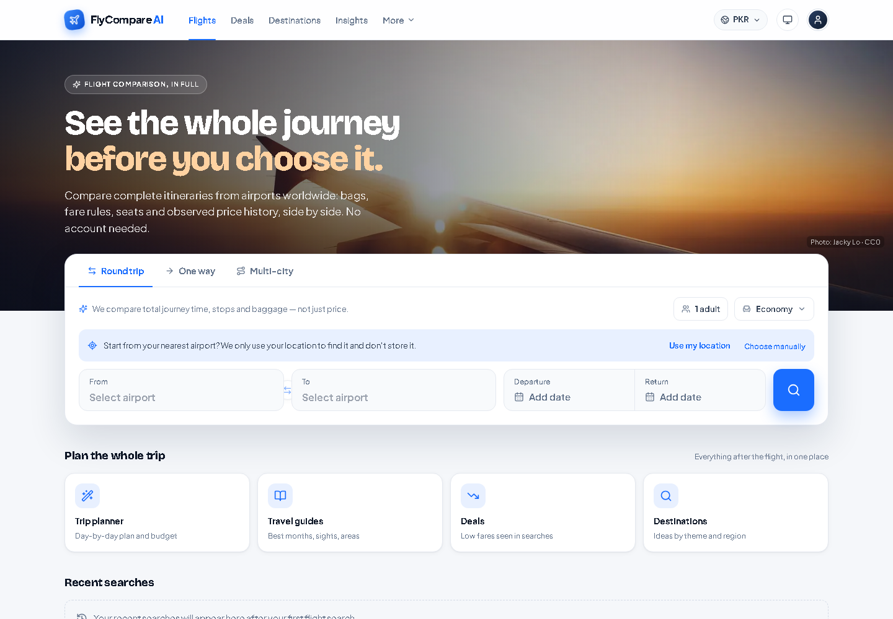
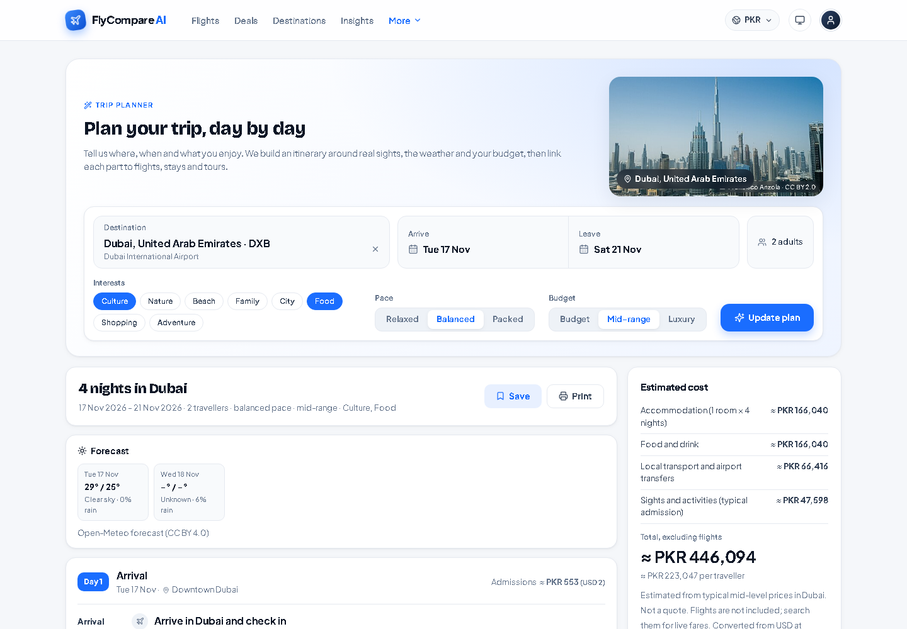
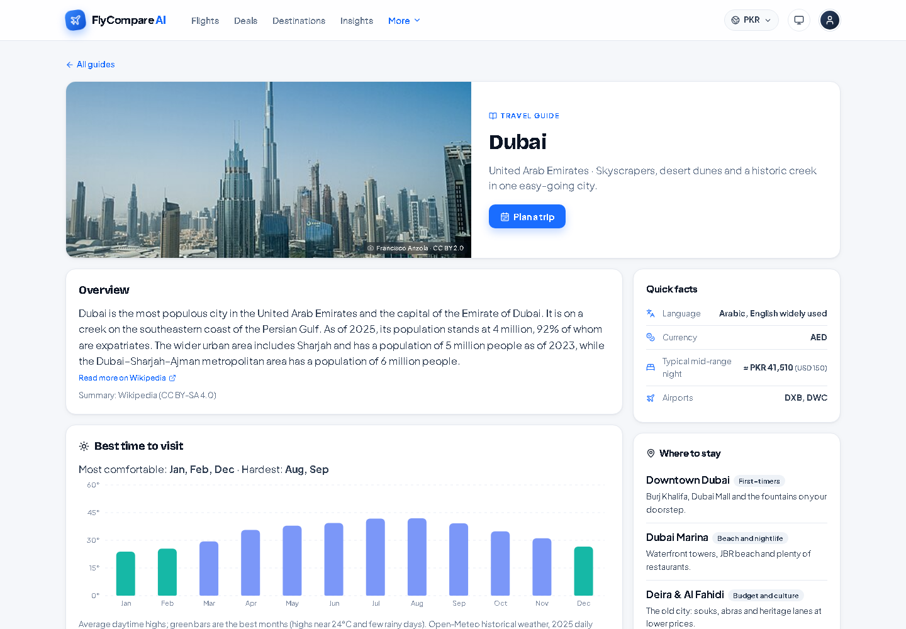
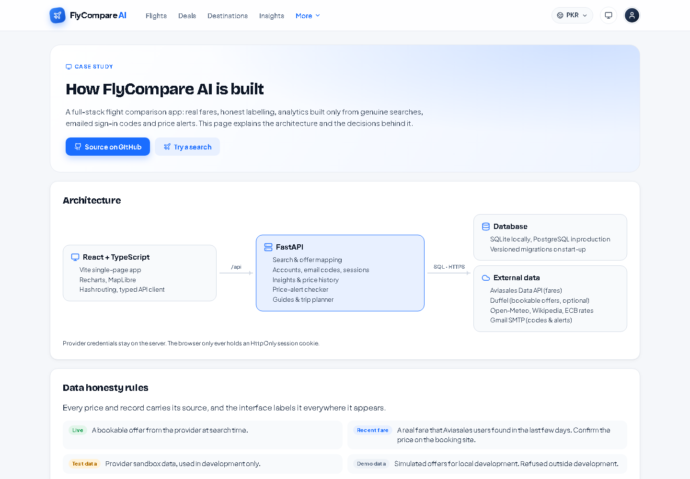
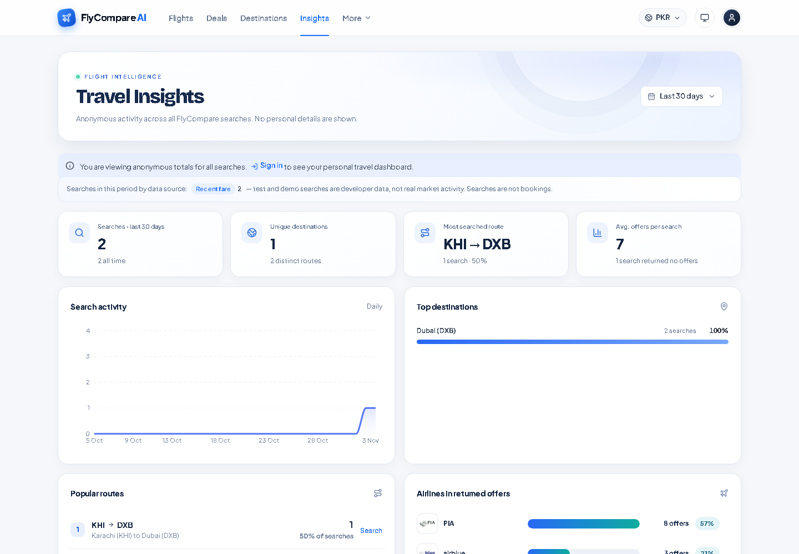
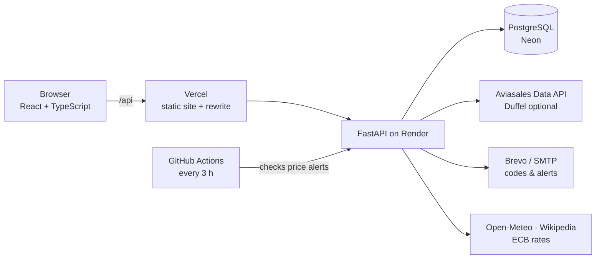

# FlyCompare AI

**Compare real flight fares, see how they change, and get emailed when your trip gets cheaper.**
A full-stack portfolio project: React + TypeScript frontend, FastAPI backend, PostgreSQL, real fare data and a strict rule that nothing on screen is invented.

**Live demo:** _coming soon_ · **Case study:** the in-app [How it's built](#how-its-built) page



## Highlights
- **Real fares.** Prices come from the Aviasales Data API (fares real travellers found in the last few days) or, optionally, Duffel's live offers. Every price is labelled **Live**, **Recent fare**, **Test** or **Demo**, and the app never fills gaps with made-up numbers.
- **Sign in with an emailed code** or a password. Codes are HMAC-hashed, single-use, expire in 10 minutes, are rate-limited, and responses never reveal whether an email is registered.
- **Price alerts.** Set a target price on any search; a background checker re-searches every few hours and emails you once per new low, with the booking link.
- **Insights from real searches.** Activity, popular routes, airlines, fares and price trends computed from stored searches; a trend is only drawn once there is enough real data.
- **Travel guides and a trip planner** built from Wikipedia, a year of Open-Meteo weather history ("best months to visit") and curated sights, with a day-by-day schedule and budget.
- **Local currency** detected from the device timezone (no location prompt), with ECB reference rates.
- **Fare model.** A log-ridge regression trained on 3.3M fare observations, shown only as a labelled estimate inside its training range.

| Trip planner | Travel guide |
|---|---|
|  |  |
| **How it's built** | **Insights** |
|  |  |

## How it's built


- **Frontend:** React 18, TypeScript, Vite, Recharts, MapLibre GL; hash routing; typed API client.
- **Backend:** FastAPI, Pydantic, SQLAlchemy; providers behind one interface (`backend/app/providers`), business logic in services, versioned migrations applied on start-up.
- **Data honesty:** demo and sandbox providers are refused outside development; currencies and data sources are never mixed in one statistic; services with no real inventory (hotels, cars, tours) are switched off rather than faked.
- **Security:** scrypt passwords, server-side sessions stored as SHA-256 hashes in HttpOnly cookies, CSRF header on state-changing requests, per-user scoping of every account endpoint, rate limits, no secrets in the repository.

## Run it locally
Requirements: Python 3.12+, Node 20+.

```bash
# backend
cd backend
python -m venv .venv
# Windows: .venv\Scripts\Activate.ps1   macOS/Linux: source .venv/bin/activate
pip install -r requirements.txt
cp ../.env.example .env        # then fill in the values you need (see below)
uvicorn app.main:app --reload --port 8000

# frontend (second terminal)
cd frontend
npm install
npm run dev                    # http://localhost:5173 (proxies /api to the backend)
```

Without any keys the app runs with simulated, clearly labelled demo flights (`FLIGHT_PROVIDER=mock`). For real data:
- **Fares:** free Travelpayouts account → join Aviasales → API token: `FLIGHT_PROVIDER=travelpayouts`, `TRAVELPAYOUTS_TOKEN`, `TRAVELPAYOUTS_MARKER`.
- **Email codes and alerts:** a Gmail App Password (`SMTP_*`) or a Brevo API key (`EMAIL_PROVIDER=brevo`).
- **Photos:** set `WIKIMEDIA_USER_AGENT` with a contact address (Wikimedia requires it).

Every setting is documented in [`.env.example`](.env.example). SQLite is used locally; set `DATABASE_URL` to PostgreSQL in production.

## Tests
```bash
cd backend && python -m pytest tests -q     # ~200 tests, offline: providers and email are stubbed
cd frontend && npm test && npm run build
cd ml && python -m pytest tests -q
```
GitHub Actions runs the backend and frontend suites on every push.

## Deploy
Free deployment on Vercel (site), Render (API), Neon (PostgreSQL) and Brevo (email): see [docs/DEPLOYMENT.md](docs/DEPLOYMENT.md).

## Data sources and credits
Fares: Aviasales via Travelpayouts (optionally Duffel). Airports: [OurAirports](https://ourairports.com/data/) (public domain) with timezones from mwgg/Airports (MIT). Weather: [Open-Meteo](https://open-meteo.com) (CC BY 4.0). Photos and summaries: Wikipedia / Wikimedia Commons under their stated free licences, credited on each image. Exchange rates: ECB via Frankfurter, plus ExchangeRate-API for other currencies. Map: Natural Earth.

FlyCompare compares fares; it does not sell or issue tickets.
